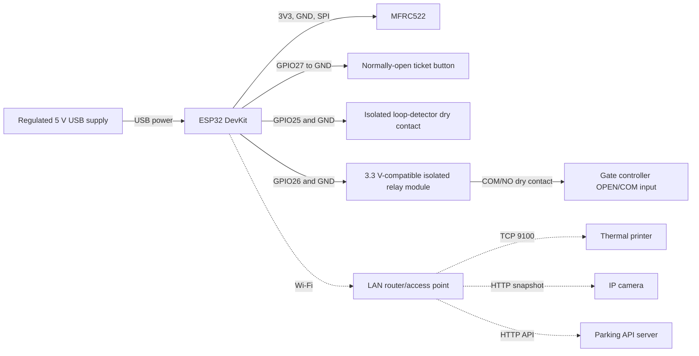

# Sistem Parkir LAN

Implementasi contoh bertahap dari PRD: PostgreSQL, REST API ASP.NET Core, aplikasi kasir WPF, dan firmware ESP32.

## 1. Database PostgreSQL

Jalankan schema pada database kosong:

```sh
psql "Host=localhost;Database=parkir;Username=postgres" -f database/schema.sql
```

Jika memakai Docker Compose, port PostgreSQL tidak dipublikasikan ke host. Gunakan shell database di dalam container:

```sh
docker compose exec db psql -U parkir -d parkir
```

Schema menambahkan tarif grace period, denda karcis hilang, dan tarif maksimum harian di `vehicle_types`. Schema tidak membuat akun atau password default. Buat akun lewat utilitas provisioning setelah database siap:

```sh
ConnectionStrings__Parking='Host=127.0.0.1;Database=parkir;Username=postgres;Password=GANTI_PASSWORD' \
  dotnet run --project tools/Parkir.UserProvisioner
```

Utilitas meminta username, nama, role (`ADMIN`/`CASHIER`), dan password tersembunyi. Buat setidaknya satu akun `CASHIER` untuk memakai POS.

Untuk membuat administrator contoh development dengan password acak yang hanya dicetak setelah akun tersimpan:

```sh
DOTNET_ROLL_FORWARD=Major ConnectionStrings__Parking='Host=127.0.0.1;Database=parkir;Username=postgres;Password=GANTI_PASSWORD' \
  dotnet run --project tools/Parkir.UserProvisioner -- --example-admin
```

Untuk membuat akun kasir contoh agar POS dapat diuji, gunakan mode yang sama:

```sh
DOTNET_ROLL_FORWARD=Major ConnectionStrings__Parking='Host=127.0.0.1;Database=parkir;Username=postgres;Password=GANTI_PASSWORD' \
  dotnet run --project tools/Parkir.UserProvisioner -- --example-cashier
```

Utilitas membuat username `cashier-demo` dan password acak yang ditampilkan sekali setelah berhasil disimpan.

Jangan menyimpan password akun demo di README atau repository. Jika database pernah memakai akun demo, rotasi password melalui utilitas provisioning dan batasi akses database hanya ke administrator. Untuk produksi, buat akun `ADMIN` dan `CASHIER` dengan password unik dari secret manager.

## 2. REST API

Persyaratan: .NET 8 SDK dan PostgreSQL. Workspace Linux ini memiliki runtime .NET 9/10, bukan runtime .NET 8; pada container ini set `DOTNET_ROLL_FORWARD=Major` saat menjalankan target net8.0. Untuk deployment biasa, pasang runtime .NET 8 yang sesuai. Atur connection string melalui environment variable, lalu jalankan API pada port yang dipakai POS dan ESP32:

```sh
export DOTNET_ROLL_FORWARD=Major
export ConnectionStrings__Parking='Host=127.0.0.1;Port=5432;Database=parkir;Username=parkir;Password=GANTI_PASSWORD'
export Security__JwtSigningKey='GANTI_DENGAN_SECRET_ACAK_MINIMAL_32_BYTE'
export Storage__ImageRoot='/var/lib/parkir/images'
export Business__TimeZone='Asia/Jakarta'
dotnet run --project backend/Parkir.Api --urls http://0.0.0.0:5080
```

API gagal start bila `ConnectionStrings__Parking` atau `Security__JwtSigningKey` tidak tersedia; tidak ada fallback kredensial database. Endpoint perangkat memakai kredensial unik per device yang dibuat melalui endpoint admin (lihat bawah), bukan API key global. Login memakai rate limit dan endpoint admin/kasir memakai JWT. Simpan secret di secret store dan batasi akses port API melalui firewall/VLAN. Untuk production, gunakan TLS di reverse proxy; set `Security__RequireHttps=true` hanya jika API sendiri menerima HTTPS atau proxy meneruskan skema dengan forwarded headers yang tepercaya. Migration di `database/migrations` dijalankan otomatis saat API start setelah tabel dasar tersedia; tabel `schema_migrations` mencatat versi yang sudah diterapkan. Endpoint `GET /health` memeriksa koneksi database dan mengembalikan `503` bila database tidak siap. Setiap response menyertakan `X-Correlation-ID` untuk penelusuran log.

Gambar disimpan di bawah `Storage__ImageRoot/YYYY-MM-DD/` dengan nama GUID dan tidak disajikan sebagai static file. Upload menerima JPEG, PNG, atau WebP sampai 5 MB; endpoint masuk memerlukan kredensial perangkat, sedangkan upload/ambil foto keluar memerlukan JWT kasir. Pastikan direktori storage masuk strategi backup dan kontrol akses filesystem.

Endpoint utama:

| Method | Endpoint | Fungsi |
| --- | --- | --- |
| `POST` | `/api/auth/login` | Login akun dan menerbitkan JWT 8 jam |
| `POST` | `/api/entries` | Membuat tiket masuk, dengan `rfidUid` dan `idempotencyKey` opsional |
| `POST` | `/api/entries/{ticketId}/print-status` | Status cetak tiket: `PRINT_SENT`, `PRINT_CONFIRMED`, atau `PRINT_FAILED` (kredensial perangkat) |
| `POST` | `/api/entries/{ticketId}/reprint` | Catat reprint beralasan dan tambah hitungan reprint (role `ADMIN`/`CASHIER`) |
| `GET` | `/api/vehicle-types` | Daftar kelas tarif untuk POS (role `CASHIER`) |
| `GET` | `/api/transactions/{ticketId}/quote?vehicleTypeId=...` | Menghitung durasi dan tagihan; `vehicleTypeId` opsional untuk simulasi kelas lain (role `CASHIER`) |
| `POST` | `/api/transactions/{ticketId}/checkout` | Menutup tiket dan mencatat pembayaran; mendukung `vehicleTypeId`, `licensePlate`, dan `overrideReason` (role `CASHIER`) |
| `POST` | `/api/transactions/{ticketId}/gate-event` | Catat command gate `SENT`/`ACKNOWLEDGED`/`EXECUTED`/`FAILED` (role `CASHIER`) |
| `POST` | `/api/transactions/{ticketId}/void` | Membatalkan tiket `UNPAID` dengan alasan dan audit (role `ADMIN`/`CASHIER`) |
| `GET` | `/api/members/{rfidUid}/verify` | Memverifikasi member aktif |
| `GET` | `/api/admin/dashboard` | Statistik kendaraan dan pendapatan hari ini (role `ADMIN`) |
| `GET`, `POST`, `PUT` | `/api/admin/vehicle-types` | Membaca dan mengatur tarif (role `ADMIN`) |
| `GET`, `POST`, `PUT` | `/api/admin/members` | Membaca, mendaftarkan, memperbarui, dan mengubah status member (role `ADMIN`) |
| `GET` | `/api/admin/reports?from=YYYY-MM-DD&to=YYYY-MM-DD` | Laporan harian, maksimal 366 hari (role `ADMIN`) |
| `GET` | `/api/admin/reports/export.csv?from=...&to=...` | Unduh laporan CSV termasuk transaksi dibayar/void/unpaid (role `ADMIN`) |
| `POST` | `/api/media/entries` | Upload JPEG/PNG/WebP masuk (kredensial perangkat, maksimal 5 MB) |
| `POST` | `/api/media/exits` | Upload foto keluar (JWT `CASHIER`, maksimal 5 MB) |
| `GET` | `/api/media/{yyyy-MM-dd}/{fileName}` | Ambil foto masuk untuk perbandingan visual (JWT `CASHIER`) |
| `POST` | `/api/devices/heartbeat` | Melaporkan last-seen perangkat (kredensial perangkat) |
| `GET` | `/api/admin/devices` | Status perangkat, online bila heartbeat <60 detik (role `ADMIN`) |
| `POST` | `/api/admin/devices/{deviceId}/credential` | Terbitkan/rotasi kredensial unik perangkat; key hanya ditampilkan sekali (role `ADMIN`) |
| `DELETE` | `/api/admin/devices/{deviceId}/credential` | Cabut kredensial perangkat (role `ADMIN`) |
| `PUT` | `/api/admin/users/{username}/status` | Aktifkan/nonaktifkan akun (role `ADMIN`) |
| `GET` | `/api/admin/gates` | Daftar gate dan status konfigurasi (role `ADMIN`) |
| `POST`, `PUT` | `/api/admin/gates` | Daftarkan gate baru atau aktifkan/nonaktifkan gate (role `ADMIN`) |

Dashboard admin tersedia di root server, misalnya `http://localhost:5080/`. Login menggunakan body `{"username":"...","password":"..."}` tanpa kredensial perangkat. POS hanya menerima akun `CASHIER`; dashboard hanya menerima akun `ADMIN`. ID kasir diambil dari JWT dan tidak diterima dari body checkout. Zona waktu bisnis dikonfigurasi lewat `Business__TimeZone` (default `Asia/Jakarta`); laporan, pergantian hari, ID tiket, dan folder foto memakai zona waktu tersebut.

Untuk menambah jalur, buka tab **Gate** sebagai admin, daftarkan `Gate ID` unik (maksimal 20 karakter), pilih arah masuk/keluar, lalu aktifkan gate. Schema baru menyiapkan `GATE-IN-01` dan `GATE-OUT-01` sebagai default. ID gate harus sama dengan ID heartbeat perangkat agar indikator ONLINE terhubung ke baris gate.

Terbitkan kredensial perangkat setelah login admin. Nilai `apiKey` hanya dikembalikan sekali dan tidak disimpan dalam plaintext:

```sh
curl -X POST http://localhost:5080/api/admin/devices/GATE-IN-01/credential \
  -H 'Authorization: Bearer JWT_ADMIN'
```

Gunakan header `X-Device-Id: GATE-IN-01` dan `X-API-Key: <apiKey>` pada endpoint perangkat. Rotasi memakai endpoint yang sama; pencabutan memakai `DELETE`. Perangkat yang dicabut atau dinonaktifkan akan menerima `401`.

Login dibatasi 5 percobaan per alamat IP dalam jendela 5 menit. Percobaan login sukses/gagal dicatat ke `audit_logs`; checkout dan audit checkout ditulis dalam transaksi database yang sama.

Contoh tiket masuk:

```sh
curl -X POST http://localhost:5080/api/entries \
  -H 'Content-Type: application/json' \
  -H 'X-Device-Id: GATE-IN-01' \
  -H 'X-API-Key: GANTI_DEVICE_KEY' \
  -d '{"gateId":"GATE-IN-01","vehicleTypeId":1,"photoInPath":null,"rfidUid":null,"idempotencyKey":"GATE-IN-01-12345"}'
```

`idempotencyKey` unik per gate mencegah tiket ganda saat firmware mengulang request setelah timeout. Request dengan kunci dan payload yang sama mengembalikan tiket pertama dengan `isNew=false`; kunci yang sama dengan gate/jenis/RFID berbeda ditolak `409`. Untuk member RFID, satu member hanya boleh memiliki satu sesi aktif; pelanggaran ditolak dan dicatat. Status member yang valid saat entry disimpan pada sesi (`member_entry_valid`), sehingga perubahan status/expiry di tengah masa parkir tidak mengubah tarif sesi tersebut. Firmware melaporkan status cetak tiket melalui `/api/entries/{ticketId}/print-status`; status `PRINT_SENT` berarti data sudah dikirim ke printer, bukan bukti fisik kertas tercetak.

Checkout reguler mengirim `gateId`, `paymentMethod`, `lostTicket:false`, `identityVerified:false`, `photoOutPath:null`, `idempotencyKey` berupa UUID, `vehicleTypeId`, `licensePlate`, `overrideReason`, dan `expectedTotalFee`. Plat nomor wajib diisi; untuk masa transisi client lama, validasi server dapat dimatikan sementara dengan `Checkout__RequireLicensePlate=false`. Jika `vehicleTypeId` berbeda dari kelas tiket, `overrideReason` wajib diisi 5-200 karakter; server menyimpan kelas asal, tarif asal, alasan, dan selisih tarif di audit. `expectedTotalFee` adalah total yang dilihat kasir; jika tarif berubah sebelum checkout, server menolak dengan `400` agar kasir memuat ulang tiket dan tidak terjadi kurang bayar. Karcis hilang harus mengirim `lostTicket:true` serta `identityVerified:true`. Kunci idempotency yang sama akan mengembalikan hasil checkout pertama, sehingga retry setelah timeout tidak menggandakan transaksi.

Formula tarif: grace period gratis; sisa durasi dibulatkan ke atas per menit lalu per jam; `max_daily_rate` adalah batas per 24 jam berjalan (sesi 25 jam memakai dua batas harian); denda karcis hilang = `lost_ticket_fee` + `max_daily_rate`. Tarif sesi memakai snapshot saat entry, bukan tarif admin yang berubah di tengah sesi. Member yang valid saat entry mempertahankan benefit member untuk sesi tersebut; non-member belum memiliki identitas plat saat entry sehingga anti-passback hanya berlaku untuk member RFID.

Void tiket yang belum dibayar:

```sh
curl -X POST http://localhost:5080/api/transactions/TKT-20261118-xxxxxxxx/void \
  -H 'Authorization: Bearer JWT_CASHIER' \
  -H 'Content-Type: application/json' \
  -d '{"reason":"Tiket tidak terpakai; kendaraan batal masuk"}'
```

## 3. Regression test

Test tarif, timezone, kontrak JSON, migrasi antrean SQLite, dan auth endpoint perangkat:

```sh
dotnet run --project tests/Parkir.Tests/Parkir.Tests.csproj
```

Test berjalan sebagai runner konsol agar tidak bergantung pada VSTest. CI juga menjalankan build API, dependency scan, secret scan, dan smoke test schema PostgreSQL.

Panduan operasi, monitoring, backup, restore drill, dan recovery ada di [`docs/OPERATIONS.md`](docs/OPERATIONS.md).

## 4. POS kasir WPF

Build dan jalankan pada Windows dengan .NET 8 SDK:

```powershell
dotnet build pos/Parkir.Pos/Parkir.Pos.csproj
dotnet run --project pos/Parkir.Pos/Parkir.Pos.csproj
```

Atur `PARKIR_DEVICE_KEY` dengan kredensial unik perangkat POS (bukan API key global), `PARKIR_DEVICE_ID`/`PARKIR_GATE_ID` unik untuk jalur keluar, dan bila perlu `PARKIR_API_URL` sebelum menjalankan POS. `PARKIR_API_KEY` masih dibaca sebagai fallback untuk kompatibilitas, tetapi nama baru yang didokumentasikan adalah `PARKIR_DEVICE_KEY`. POS mengirim header `X-Device-Id` dan `X-API-Key` untuk heartbeat; ID device harus sama dengan Gate ID agar status monitoring cocok. POS mengirim heartbeat tiap 20 detik dan berhenti mengirim heartbeat saat sesi JWT berakhir. Jendela login hanya mengizinkan role `CASHIER`; token berlaku delapan jam dan POS meminta login ulang lima menit sebelum kedaluwarsa atau saat server mengembalikan `401`. Alur POS dimulai dari plat nomor, lalu scan tiket; plat dan kelas tarif yang dipilih dikirim saat checkout, dan kelas tarif dapat dipilih dengan `F1` (Motor), `F2` (Mobil), atau `F3` (Truk). Jika kelas diubah dari tiket masuk, kasir wajib mengisi alasan perubahan. Pemindai barcode yang bekerja sebagai keyboard HID dapat langsung mengisi nomor tiket dan menekan Enter. POS menampilkan foto masuk dan mengunggah foto keluar sebelum checkout. Jika `PARKIR_OUT_CAMERA_URL` tidak diatur, petugas dapat memilih file JPEG/PNG/WebP; URL kamera harus mengembalikan satu snapshot dengan Content-Type dan Content-Length. Checkout disimpan lebih dahulu di SQLite pada `%LOCALAPPDATA%/Parkir/Pos` dengan status `PENDING`/`SENT`/`CONFIRMED`/`FAILED`/`HARDWARE_DONE` dan dikirim ulang tiap 10 detik dengan idempotency key yang sama. Quote dan validasi tarif tetap memerlukan server; POS tidak melakukan pembayaran final offline. Error `4xx` permanen masuk antrean gagal dengan tombol tindakan; error jaringan/`5xx` di-retry dengan backoff. Antrean menulis `outbox.log`, memakai WAL/busy timeout, dan membatasi ACL file SQLite secara best-effort pada Windows. Jika server belum mengonfirmasi, jangan buka palang; jangan anggap pembayaran/tiket selesai sampai POS menampilkan konfirmasi server.

Setelah server mengonfirmasi checkout, POS mencoba mencetak ESC/POS lewat TCP: set `PARKIR_RECEIPT_HOST` dan opsional `PARKIR_RECEIPT_PORT` (default 9100). Relay serial nonaktif kecuali `PARKIR_RELAY_PORT` dan `PARKIR_RELAY_OPEN_HEX` diatur; `PARKIR_RELAY_BAUD` default 9600. Isi byte hex sesuai protokol relay yang benar dan atur hardware ke pulse/self-release yang aman. POS mengirim event command gate (`SENT`, lalu `EXECUTED`/`FAILED`) ke API dengan command ID untuk audit; kegagalan pelaporan event tidak menghalangi pembayaran. Jika printer/relay tidak tersedia, pembayaran tetap tercatat dan POS memberi status untuk penanganan manual; verifikasi relay pada bench sebelum menghubungkannya ke palang.

## 5. Gerbang masuk ESP32

Project PlatformIO ada di `firmware/gate_in`:

```sh
cd firmware/gate_in
pio run
pio run --target upload
pio device monitor
```

Sesuaikan SSID, password, URL API, `API_MEDIA_URL`, `API_HEARTBEAT_URL`, `API_KEY`, `CAMERA_SNAPSHOT_URL`, alamat printer, dan `VEHICLE_TYPE_ID` pada `gate_in.ino`. `API_KEY` wajib berisi kredensial unik gate yang diterbitkan admin; jangan memakai key yang sama untuk gate lain. Setiap ESP32 memiliki Gate ID sendiri: kirim `SET_GATE_ID=GATE-IN-02` di Serial Monitor saat commissioning; firmware menyimpan ID ke NVS dan mengirimnya sebagai `X-Device-Id`. Daftarkan ID yang sama di tab Gate admin lalu terbitkan kredensial untuk ID tersebut. Gate mengirim heartbeat tiap 20 detik dan mencoba reconnect Wi-Fi dengan exponential backoff tanpa memblokir loop sensor. Firmware mengirim `idempotencyKey` per percobaan tiket sehingga retry setelah timeout tidak membuat tiket ganda; kunci dipertahankan sampai tiket berhasil dicetak. Status cetak dilaporkan ke server (`PRINT_SENT`/`PRINT_FAILED`); `PRINT_SENT` bukan bukti fisik kertas. Palang menunggu minimal 800 ms sebelum boleh menutup dan ditutup paksa setelah 15 detik bila sensor loop tidak melepas. Kamera harus menyediakan endpoint snapshot HTTP yang mengembalikan JPEG/PNG/WebP dengan Content-Length. Pin default: tombol GPIO 27, sensor loop GPIO 25, relay GPIO 26, RFID SS GPIO 5 dan RST GPIO 4. Input tombol/sensor diasumsikan aktif LOW, sedangkan relay diasumsikan aktif HIGH. Verifikasi level listrik dan pin aktual sebelum menghubungkan perangkat.

### Schematic Wiring Gate-In

Diagram mengikuti pin `firmware/gate_in/gate_in.ino`. Kamera, printer, dan API memakai LAN/Wi-Fi, bukan koneksi GPIO langsung.



| ESP32 DevKit | Sambungkan ke | Catatan |
| --- | --- | --- |
| `3V3`, `GND` | `3.3V/VCC`, `GND` MFRC522 | MFRC522 gunakan 3.3 V, jangan 5 V. |
| `GPIO18`, `GPIO19`, `GPIO23` | `SCK`, `MISO`, `MOSI` MFRC522 | SPI default dari `SPI.begin()`. |
| `GPIO5`, `GPIO4` | `SDA/SS`, `RST` MFRC522 | `SDA` adalah chip-select SPI, bukan I2C. GPIO5 strapping pin; jangan ditahan LOW saat boot. |
| `GPIO27`, `GND` | Tombol normally-open di antara pin dan ground | `INPUT_PULLUP`: ditekan = LOW. |
| `GPIO25`, `GND` | Kontak kering detector `NO`, `COM` | Kendaraan terdeteksi harus menutup kontak sehingga GPIO25 LOW. Output 12/24 V perlu isolator; jangan langsung ke GPIO. |
| `GPIO26`, `GND` | `IN`, `GND` relay module kompatibel 3.3 V | Aktif-HIGH; jangan hubungkan koil relay langsung ke pin. Ikuti datasheet modul untuk catu/isolasi. |
| Relay `COM`, `NO` | Gate controller `COM/GND`, `OPEN/START` | Hanya sebagai dry contact low-voltage yang disetujui pabrikan. Jangan hubungkan ke motor atau listrik AC. |

ESP32 dicatu melalui USB regulated 5 V. Printer, kamera, dan server tersambung ke router LAN; contoh IP di firmware: API `192.168.1.10:5080`, kamera `192.168.1.60`, printer `192.168.1.50:9100`. Printer berkomunikasi via TCP/IP, bukan UART.

**Keselamatan:** gunakan photocell, safety edge, emergency stop, limit switch, dan proteksi anti-crush independen dari ESP32. Saat boot/reset, kontak relay harus terbuka. Uji level tegangan, polaritas detector, mode pulse/self-release gate controller, dan interlock di bench sebelum menghubungkan aktuator. Pinout gate controller serta tegangan detector bergantung pada perangkat yang dipakai; verifikasi datasheet hardware aktual.

Printer tiket masuk menggunakan ESC/POS melalui TCP port 9100. Pembukaan palang hanya terjadi setelah server membuat tiket dan printer menerima koneksi. Palang menutup setelah sensor menyatakan area kosong; gunakan juga kontrol keselamatan/fotokel independen dan interlock hardware yang sesuai. Kegagalan Wi-Fi/API berarti tiket tidak diterbitkan dan palang tidak dibuka.

## 6. Dokumentasi perangkat dan pilot

- [`docs/adr/0001-gate-out-architecture.md`](docs/adr/0001-gate-out-architecture.md) — keputusan arsitektur Gate-Out.
- [`docs/DEVICE_MAPPING.md`](docs/DEVICE_MAPPING.md) — template pemetaan gate/perangkat (tanpa secret).
- [`docs/HARDWARE_TEST_PLAN.md`](docs/HARDWARE_TEST_PLAN.md) — prosedur bench/hardware-in-the-loop.
- [`docs/PILOT_READINESS.md`](docs/PILOT_READINESS.md) — checklist go/no-go pilot.
- [`hardware/gate_in/wiring.md`](hardware/gate_in/wiring.md) dan [`hardware/gate_out/wiring.md`](hardware/gate_out/wiring.md) — wiring Gate-In/Gate-Out.

## Deploy dan rollback

1. Backup database sebelum deploy.
2. Deploy API. Migration `002`-`013` diterapkan otomatis oleh runner dan dicatat di `schema_migrations`; cek `GET /health` sampai `200`.
3. Terbitkan kredensial unik untuk setiap gate/POS melalui endpoint admin. Jangan memakai key yang sama untuk beberapa perangkat.
4. Deploy POS baru. Verifikasi login ulang, antrean checkout, cetak struk, dan relay di bench.
5. Deploy firmware dengan `X-Device-Id` dan kredensial gate masing-masing.
6. Rollback aplikasi dilakukan dengan mengembalikan binary API/POS sebelumnya. Kolom baru bersifat nullable dan field request baru opsional, sehingga rollback binary tidak memerlukan drop column. Migration bersifat forward-only; jangan menghapus `schema_migrations`.
7. Saat masa transisi dari POS lama yang belum mengirim plat, set `Checkout__RequireLicensePlate=false` pada API baru, deploy POS baru, lalu kembalikan ke `true`.
8. Migration anti-passback `010` akan menolak startup bila database masih memiliki lebih dari satu sesi aktif untuk member yang sama. Selesaikan sesi duplikat melalui prosedur operasional sebelum deploy; jangan menghapus data transaksi secara manual.

## Batas contoh

JWT dan role memisahkan akses kasir/admin; kredensial unik per perangkat mengautentikasi endpoint perangkat. API masih menggunakan HTTP pada contoh; pasang TLS di reverse proxy dan set `Security__RequireHttps=true` sebelum produksi. Audit mencakup login, checkout, perubahan tarif/member, kredensial perangkat, dan status user. Dashboard menyediakan laporan harian rentang tanggal dan ekspor CSV. Endpoint kamera menggunakan HTTP snapshot generik, sehingga autentikasi, format, dan alamat perlu disesuaikan dengan kamera aktual. Perintah serial relay POS bergantung pada byte protokol modul dan wajib diuji terpisah sebelum mengendalikan palang. Outbox POS hanya menyimpan checkout untuk retry dan tidak membuka palang secara offline. Firmware menggunakan Wi-Fi; ganti transport jaringan jika instalasi memakai Ethernet W5500.
