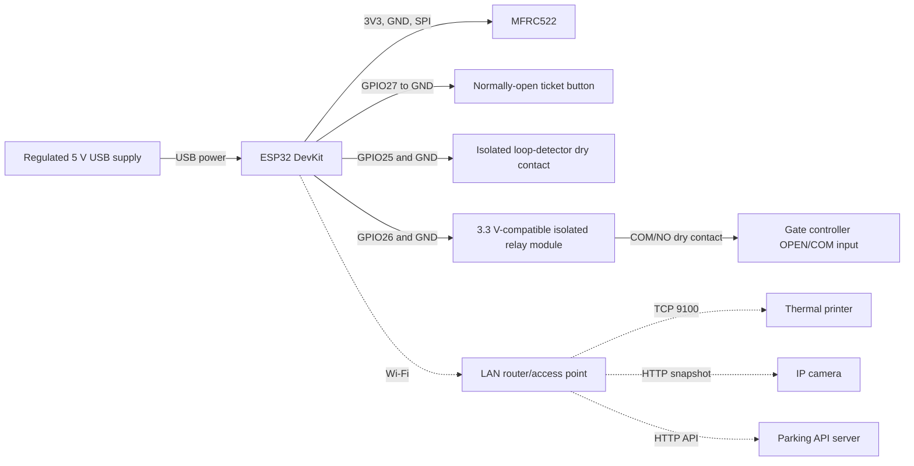

# Sistem Parkir LAN

Implementasi contoh bertahap dari PRD: PostgreSQL, REST API ASP.NET Core, aplikasi kasir WPF, dan firmware ESP32.

## 1. Database PostgreSQL

Jalankan schema pada database kosong:

```sh
psql "Host=localhost;Database=parkir;Username=postgres" -f database/schema.sql
```

Schema menambahkan tarif grace period, denda karcis hilang, dan tarif maksimum harian di `vehicle_types`. Schema tidak membuat akun atau password default. Buat akun lewat utilitas provisioning setelah database siap:

```sh
ConnectionStrings__Parking='Host=127.0.0.1;Database=parkir;Username=postgres;Password=GANTI_PASSWORD' \
  dotnet run --project tools/Parkir.UserProvisioner
```

Utilitas meminta username, nama, role (`ADMIN`/`CASHIER`), dan password tersembunyi. Buat setidaknya satu akun `CASHIER` untuk memakai POS.

Untuk membuat administrator contoh development dengan password acak yang hanya dicetak setelah akun tersimpan:

```sh
DOTNET_ROLL_FORWARD=Major ConnectionStrings__Parking='Host=127.0.0.1;Database=parkir;Username=postgres;Password=GANTI_PASSWORD' \
  dotnet run --project tools/Parkir.UserProvisioner -- --example-admin
```

Untuk membuat akun kasir contoh agar POS dapat diuji, gunakan mode yang sama:

```sh
DOTNET_ROLL_FORWARD=Major ConnectionStrings__Parking='Host=127.0.0.1;Database=parkir;Username=postgres;Password=GANTI_PASSWORD' \
  dotnet run --project tools/Parkir.UserProvisioner -- --example-cashier
```

Utilitas membuat username `cashier-demo` dan password acak yang ditampilkan sekali setelah berhasil disimpan.

Kredensial akun demo development yang sudah dibuat pada database lokal:

- Username: `admin-demo`
- Password: `nlXFkov2FZGEaxnPhQ8pv9Kuq4rQhBzn`
- Username: `cashier-demo`
- Password: `xrikhhmNGOhme-g2wrh0ImVSX_OrpQuh`

Password akun demo disimpan di README atas permintaan untuk kemudahan pengujian. Jangan gunakan kredensial ini di produksi atau pada database/jaringan bersama; bila repository dibagikan, hapus password dari README dan buat akun produksi dengan password baru. Jika database lokal dibuat ulang, jalankan utilitas di atas lagi untuk menghasilkan akun baru.

## 2. REST API

Persyaratan: .NET 8 SDK dan PostgreSQL. Workspace Linux ini memiliki runtime .NET 9/10, bukan runtime .NET 8; pada container ini set `DOTNET_ROLL_FORWARD=Major` saat menjalankan target net8.0. Untuk deployment biasa, pasang runtime .NET 8 yang sesuai. Atur connection string melalui environment variable, lalu jalankan API pada port yang dipakai POS dan ESP32:

```sh
export DOTNET_ROLL_FORWARD=Major
export ConnectionStrings__Parking='Host=127.0.0.1;Port=5432;Database=parkir;Username=postgres;Password=GANTI_PASSWORD'
export Security__ApiKey='GANTI_DENGAN_KUNCI_ACAK_PANJANG'
export Security__JwtSigningKey='GANTI_DENGAN_SECRET_ACAK_MINIMAL_32_BYTE'
export Storage__ImageRoot='/var/lib/parkir/images'
dotnet run --project backend/Parkir.Api --urls http://0.0.0.0:5080
```

API key hanya diwajibkan untuk endpoint perangkat `/api/entries`, `/api/members/*`, dan heartbeat; login memakai rate limit dan endpoint admin/kasir memakai JWT. Secret JWT wajib berbeda dan minimal 32 byte. Simpan secret di secret store dan batasi akses port API melalui firewall/VLAN. Jika database sudah memakai schema lama, jalankan migrasi `002_add_checkout_idempotency.sql`, `003_add_audit_logs.sql`, `004_add_device_heartbeats.sql`, lalu `005_add_gate_registry.sql` satu kali.

Gambar disimpan di bawah `Storage__ImageRoot/YYYY-MM-DD/` dengan nama GUID dan tidak disajikan sebagai static file. Upload menerima JPEG, PNG, atau WebP sampai 5 MB; endpoint masuk memerlukan API key, sedangkan upload/ambil foto keluar memerlukan JWT kasir. Pastikan direktori storage masuk strategi backup dan kontrol akses filesystem.

Endpoint utama:

| Method | Endpoint | Fungsi |
| --- | --- | --- |
| `POST` | `/api/auth/login` | Login akun dan menerbitkan JWT 8 jam |
| `POST` | `/api/entries` | Membuat tiket masuk, dengan `rfidUid` opsional |
| `GET` | `/api/transactions/{ticketId}/quote` | Menghitung durasi dan tagihan (role `CASHIER`) |
| `POST` | `/api/transactions/{ticketId}/checkout` | Menutup tiket dan mencatat pembayaran (role `CASHIER`) |
| `GET` | `/api/members/{rfidUid}/verify` | Memverifikasi member aktif |
| `GET` | `/api/admin/dashboard` | Statistik kendaraan dan pendapatan hari ini (role `ADMIN`) |
| `GET`, `POST`, `PUT` | `/api/admin/vehicle-types` | Membaca dan mengatur tarif (role `ADMIN`) |
| `GET`, `POST`, `PUT` | `/api/admin/members` | Membaca, mendaftarkan, dan mengubah status member (role `ADMIN`) |
| `GET` | `/api/admin/reports?from=YYYY-MM-DD&to=YYYY-MM-DD` | Laporan harian, maksimal 366 hari (role `ADMIN`) |
| `GET` | `/api/admin/reports/export.csv?from=...&to=...` | Unduh laporan CSV (role `ADMIN`) |
| `POST` | `/api/media/entries` | Upload JPEG/PNG/WebP masuk (API key perangkat, maksimal 5 MB) |
| `POST` | `/api/media/exits` | Upload foto keluar (JWT `CASHIER`, maksimal 5 MB) |
| `GET` | `/api/media/{yyyy-MM-dd}/{fileName}` | Ambil foto masuk untuk perbandingan visual (JWT `CASHIER`) |
| `POST` | `/api/devices/heartbeat` | Melaporkan last-seen perangkat (API key perangkat) |
| `GET` | `/api/admin/devices` | Status perangkat, online bila heartbeat <60 detik (role `ADMIN`) |
| `GET` | `/api/admin/gates` | Daftar gate dan status konfigurasi (role `ADMIN`) |
| `POST`, `PUT` | `/api/admin/gates` | Daftarkan gate baru atau aktifkan/nonaktifkan gate (role `ADMIN`) |

Dashboard admin tersedia di root server, misalnya `http://localhost:5080/`. Login menggunakan body `{"username":"...","password":"..."}` tanpa API key perangkat. POS hanya menerima akun `CASHIER`; dashboard hanya menerima akun `ADMIN`. ID kasir diambil dari JWT dan tidak diterima dari body checkout.

Untuk menambah jalur, buka tab **Gate** sebagai admin, daftarkan `Gate ID` unik (maksimal 20 karakter), pilih arah masuk/keluar, lalu aktifkan gate. Schema baru menyiapkan `GATE-IN-01` dan `GATE-OUT-01` sebagai default. ID gate harus sama dengan ID heartbeat perangkat agar indikator ONLINE terhubung ke baris gate.

Login dibatasi 5 percobaan per alamat IP dalam jendela 5 menit. Percobaan login sukses/gagal dicatat ke `audit_logs`; checkout dan audit checkout ditulis dalam transaksi database yang sama.

Contoh tiket masuk:

```sh
curl -X POST http://localhost:5080/api/entries \
  -H 'Content-Type: application/json' \
  -d '{"gateId":"GATE-IN-01","vehicleTypeId":1,"photoInPath":null,"rfidUid":null}'
```

Checkout reguler mengirim `gateId`, `paymentMethod`, `lostTicket:false`, `identityVerified:false`, `photoOutPath:null`, dan `idempotencyKey` berupa UUID. Karcis hilang harus mengirim `lostTicket:true` serta `identityVerified:true`. Kunci idempotency yang sama akan mengembalikan hasil checkout pertama, sehingga retry setelah timeout tidak menggandakan transaksi.

## 3. POS kasir WPF

Build dan jalankan pada Windows dengan .NET 8 SDK:

```powershell
dotnet build pos/Parkir.Pos/Parkir.Pos.csproj
dotnet run --project pos/Parkir.Pos/Parkir.Pos.csproj
```

Atur `PARKIR_API_KEY`, `PARKIR_GATE_ID` unik untuk jalur keluar, dan bila perlu `PARKIR_API_URL` sebelum menjalankan POS. POS menggunakan `PARKIR_GATE_ID` sebagai ID device heartbeat; jika `PARKIR_DEVICE_ID` diatur, nilainya harus sama dengan Gate ID agar status monitoring cocok. POS mengirim heartbeat tiap 20 detik. Jendela login hanya mengizinkan role `CASHIER`; token berlaku delapan jam. Pemindai barcode yang bekerja sebagai keyboard HID dapat langsung mengisi nomor tiket dan menekan Enter. POS menampilkan foto masuk dan mengunggah foto keluar sebelum checkout. Jika `PARKIR_OUT_CAMERA_URL` tidak diatur, petugas dapat memilih file JPEG/PNG/WebP; URL kamera harus mengembalikan satu snapshot dengan Content-Type dan Content-Length. Checkout disimpan lebih dahulu di SQLite pada `%LOCALAPPDATA%/Parkir/Pos` dan dikirim ulang tiap 10 detik dengan idempotency key yang sama. Jika server belum mengonfirmasi, jangan buka palang; jangan anggap pembayaran/tiket selesai sampai POS menampilkan konfirmasi server.

Setelah server mengonfirmasi checkout, POS mencoba mencetak ESC/POS lewat TCP: set `PARKIR_RECEIPT_HOST` dan opsional `PARKIR_RECEIPT_PORT` (default 9100). Relay serial nonaktif kecuali `PARKIR_RELAY_PORT` dan `PARKIR_RELAY_OPEN_HEX` diatur; `PARKIR_RELAY_BAUD` default 9600. Isi byte hex sesuai protokol relay yang benar dan atur hardware ke pulse/self-release yang aman. Jika printer/relay tidak tersedia, pembayaran tetap tercatat dan POS memberi status untuk penanganan manual; verifikasi relay pada bench sebelum menghubungkannya ke palang.

## 4. Gerbang masuk ESP32

Project PlatformIO ada di `firmware/gate_in`:

```sh
cd firmware/gate_in
pio run
pio run --target upload
pio device monitor
```

Sesuaikan SSID, password, URL API, `API_MEDIA_URL`, `API_HEARTBEAT_URL`, `API_KEY`, `CAMERA_SNAPSHOT_URL`, alamat printer, dan `VEHICLE_TYPE_ID` pada `gate_in.ino`. Setiap ESP32 memiliki Gate ID sendiri: kirim `SET_GATE_ID=GATE-IN-02` di Serial Monitor saat commissioning; firmware menyimpan ID ke NVS. Daftarkan ID yang sama di tab Gate admin. Gate mengirim heartbeat tiap 20 detik. Kamera harus menyediakan endpoint snapshot HTTP yang mengembalikan JPEG/PNG/WebP dengan Content-Length. Pin default: tombol GPIO 27, sensor loop GPIO 25, relay GPIO 26, RFID SS GPIO 5 dan RST GPIO 4. Input tombol/sensor diasumsikan aktif LOW, sedangkan relay diasumsikan aktif HIGH. Verifikasi level listrik dan pin aktual sebelum menghubungkan perangkat.

### Schematic Wiring Gate-In

Diagram mengikuti pin `firmware/gate_in/gate_in.ino`. Kamera, printer, dan API memakai LAN/Wi-Fi, bukan koneksi GPIO langsung.



| ESP32 DevKit | Sambungkan ke | Catatan |
| --- | --- | --- |
| `3V3`, `GND` | `3.3V/VCC`, `GND` MFRC522 | MFRC522 gunakan 3.3 V, jangan 5 V. |
| `GPIO18`, `GPIO19`, `GPIO23` | `SCK`, `MISO`, `MOSI` MFRC522 | SPI default dari `SPI.begin()`. |
| `GPIO5`, `GPIO4` | `SDA/SS`, `RST` MFRC522 | `SDA` adalah chip-select SPI, bukan I2C. GPIO5 strapping pin; jangan ditahan LOW saat boot. |
| `GPIO27`, `GND` | Tombol normally-open di antara pin dan ground | `INPUT_PULLUP`: ditekan = LOW. |
| `GPIO25`, `GND` | Kontak kering detector `NO`, `COM` | Kendaraan terdeteksi harus menutup kontak sehingga GPIO25 LOW. Output 12/24 V perlu isolator; jangan langsung ke GPIO. |
| `GPIO26`, `GND` | `IN`, `GND` relay module kompatibel 3.3 V | Aktif-HIGH; jangan hubungkan koil relay langsung ke pin. Ikuti datasheet modul untuk catu/isolasi. |
| Relay `COM`, `NO` | Gate controller `COM/GND`, `OPEN/START` | Hanya sebagai dry contact low-voltage yang disetujui pabrikan. Jangan hubungkan ke motor atau listrik AC. |

ESP32 dicatu melalui USB regulated 5 V. Printer, kamera, dan server tersambung ke router LAN; contoh IP di firmware: API `192.168.1.10:5080`, kamera `192.168.1.60`, printer `192.168.1.50:9100`. Printer berkomunikasi via TCP/IP, bukan UART.

**Keselamatan:** gunakan photocell, safety edge, emergency stop, limit switch, dan proteksi anti-crush independen dari ESP32. Saat boot/reset, kontak relay harus terbuka. Uji level tegangan, polaritas detector, mode pulse/self-release gate controller, dan interlock di bench sebelum menghubungkan aktuator. Pinout gate controller serta tegangan detector bergantung pada perangkat yang dipakai; verifikasi datasheet hardware aktual.

Printer tiket masuk menggunakan ESC/POS melalui TCP port 9100. Pembukaan palang hanya terjadi setelah server membuat tiket dan printer menerima koneksi. Palang menutup setelah sensor menyatakan area kosong; gunakan juga kontrol keselamatan/fotokel independen dan interlock hardware yang sesuai. Kegagalan Wi-Fi/API berarti tiket tidak diterbitkan dan palang tidak dibuka.

## Batas contoh

JWT dan role memisahkan akses kasir/admin; API key mengautentikasi endpoint perangkat. API masih menggunakan HTTP pada contoh; pasang TLS dan mekanisme rotasi secret sebelum produksi. Audit mencakup login, checkout, dan perubahan tarif/member. Dashboard menyediakan laporan harian rentang tanggal dan ekspor CSV. Endpoint kamera menggunakan HTTP snapshot generik, sehingga autentikasi, format, dan alamat perlu disesuaikan dengan kamera aktual. Perintah serial relay POS bergantung pada byte protokol modul dan wajib diuji terpisah sebelum mengendalikan palang. Outbox POS hanya menyimpan checkout untuk retry dan tidak membuka palang secara offline. Firmware menggunakan Wi-Fi; ganti transport jaringan jika instalasi memakai Ethernet W5500.