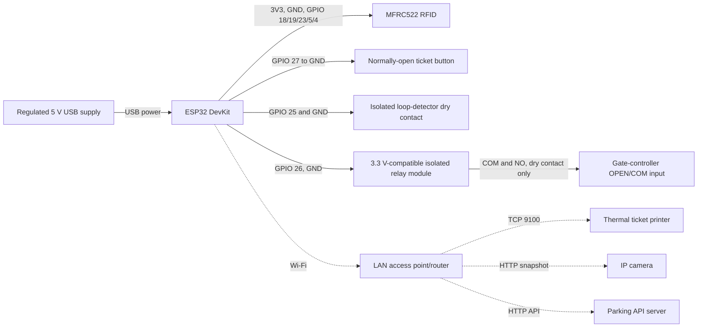

# Wiring Gate-In ESP32

Diagram ini mengikuti pin pada `firmware/gate_in/gate_in.ino`. Kamera, printer, dan API memakai LAN/Wi-Fi; ketiganya tidak disambungkan langsung ke GPIO.

## Pin dan koneksi

| ESP32 DevKit | Sambungkan ke | Catatan |
| --- | --- | --- |
| `3V3` | `3.3V/VCC` MFRC522 | Jangan beri MFRC522 tegangan 5 V. |
| `GND` | `GND` MFRC522 | Ground bersama untuk sinyal SPI. |
| `GPIO18` | `SCK` MFRC522 | SPI clock default dari `SPI.begin()`. |
| `GPIO19` | `MISO` MFRC522 | Data reader ke ESP32. |
| `GPIO23` | `MOSI` MFRC522 | Data ESP32 ke reader. |
| `GPIO5` | `SDA/SS` MFRC522 | Label `SDA` pada modul MFRC522 adalah chip-select SPI, bukan I2C. GPIO5 adalah strapping pin; pastikan reader tidak menahannya LOW saat boot. |
| `GPIO4` | `RST` MFRC522 | Reset reader. |
| `GPIO27` | Satu sisi tombol; sisi lain ke `GND` | Tombol normally-open; `INPUT_PULLUP`, ditekan = LOW. |
| `GPIO25` | `NO` kontak kering loop detector; `COM` kontak ke `GND` | Saat kendaraan terdeteksi kontak menutup dan GPIO25 LOW. Cocokkan NO/NC dengan output detector. |
| `GPIO26` | `IN` relay module yang menerima logika 3.3 V | Firmware aktif-HIGH; HIGH saat perintah buka, LOW saat tutup. Jangan sambungkan koil relay langsung ke GPIO. |
| `GND` | `GND` relay module jika input tidak terisolasi | Untuk modul opto-isolated, ikuti skema ground pada datasheet. |

## Kontak relay palang

Gunakan kontak relay **normally-open** sebagai sakelar sesaat pada input kontrol gate:

| Relay module | Gate controller |
| --- | --- |
| `COM` | Terminal `COM/GND` input tombol buka |
| `NO` | Terminal `OPEN/START` input tombol buka |

Kontak ini hanya untuk input kontrol low-voltage/dry-contact yang disediakan pabrikan. Jangan sambungkan ESP32 atau relay kecil langsung ke motor, kabel listrik AC, atau output bertegangan dari gate controller. Jika gate controller tidak menerima dry contact, gunakan antarmuka isolasi yang ditentukan pabrikan.

Firmware menahan GPIO26 HIGH sampai loop detector menyatakan area kosong, lalu menurunkannya LOW. Gate controller tetap harus memiliki photocell, safety edge, emergency stop, limit switch, dan proteksi anti-crush independen. Jangan mengandalkan ESP32 sebagai satu-satunya sistem keselamatan; uji kondisi sensor gagal/stuck sebelum operasi.

## Power dan jaringan

- Beri ESP32 daya melalui USB regulated 5 V yang sesuai dengan DevKit. Jangan catu GPIO dengan 5 V.
- Relay module mungkin memerlukan catu terpisah. Ikuti datasheet; hindari mengambil arus koil dari pin 3V3 ESP32.
- Loop detector sering mengeluarkan 12/24 V atau memakai relay internal. Jangan hubungkan output bertegangan langsung ke GPIO25; gunakan kontak kering atau optocoupler/level interface terisolasi.
- Hubungkan ESP32 ke SSID LAN. Printer, kamera, dan API server harus dapat dijangkau di jaringan yang sama. Contoh source: API `192.168.1.10:5080`, kamera `192.168.1.60`, printer `192.168.1.50:9100`.
- Printer berkomunikasi melalui TCP/IP, bukan UART langsung dari ESP32.

## Sebelum memberi daya

1. Pastikan nomor GPIO cocok dengan firmware dan tidak ada modul yang memberi 5 V pada input ESP32.
2. Dengan gate controller dilepas, ukur kontak COM/NO relay dan pastikan terbuka saat ESP32 boot/reset.
3. Uji sensor: kendaraan terdeteksi harus membuat GPIO25 LOW; area kosong harus HIGH.
4. Uji tombol: tidak ditekan HIGH; ditekan LOW.
5. Uji gate controller di bench dengan semua interlock keselamatan aktif sebelum menyambungkan aktuator.

Pinout gate controller, tegangan detector, dan jenis relay belum ditentukan PRD. Verifikasi terminal serta rating perangkat aktual sebelum instalasi.